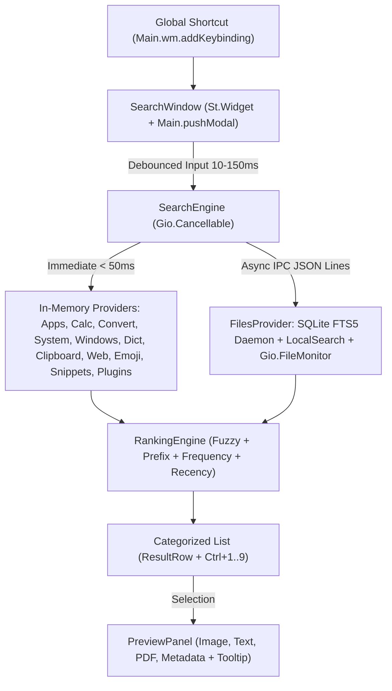

# Architecture — Lumen Spotlight

Lumen Spotlight is a native **GNOME Shell 50 (Wayland)** extension written in **GJS (ES Modules)**, **GTK4 / libadwaita** (for Preferences), and a persistent **Python 3 SQLite FTS5** indexing daemon.

---

## GNOME Shell 50 / Mutter 18 / GJS 1.88 Compatibility

1. **Container Orientation (`St.BoxLayout` / `St.ScrollView`)**:
   Uses `orientation: Clutter.Orientation.VERTICAL` and `Clutter.Orientation.HORIZONTAL` instead of the deprecated `vertical` property.
2. **Backdrop Blur (`Shell.BlurEffect`)**:
   Uses `Shell.BlurEffect` with `radius` and `mode: Shell.BlurMode.BACKDROP`, with automatic fallback to CSS acrylic translucency (`lumen-fallback-acrylic`) when animations are disabled or `blur-mode` is set to `css-only`.
3. **Monitor Geometry**:
   Uses `global.display.get_current_monitor()` and `Main.layoutManager.monitors[index]` without the removed `Meta.Rectangle`.
4. **Top Chrome & Wayland Overlay Lifecycle**:
   `SearchWindow` attaches `_backdrop` to `Main.layoutManager.addTopChrome(actor, { trackFullscreen: true })` only while visible and detaches it immediately on hide (`removeChrome`) to prevent stale input capture across `Alt+Tab` or workspace switches.
5. **Process Isolation (`prefs.js`)**:
   `prefs.js` imports only `Adw`, `Gdk`, `Gio`, `GLib`, `Gtk`, and `src/core/settings.js` — never touching GNOME Shell compositor modules (`St`, `Clutter`, `Meta`, `Shell`).

---

## Data Flow



---

## Project Layout

```text
lumen-spotlight/
├── extension.js                 # Extension lifecycle (enable / disable) & provider registration
├── prefs.js                     # GTK4 / libadwaita Preferences window (4 pages)
├── metadata.json                # GNOME Shell extension manifest (UUID, shell-version: 50)
├── stylesheet.css               # 6 themes (Spotlight Dark, Liquid Glass, Crystal, Obsidian, Nord, Catppuccin)
├── schemas/
│   └── org.gnome.shell.extensions.lumen.gschema.xml
├── src/
│   ├── core/
│   │   ├── index.js             # FileIndexManager (IPC, Gio.FileMonitor, LocalSearch, query parser)
│   │   ├── indexerDaemon.py     # Persistent Python 3 SQLite FTS5 + WAL daemon (BFS indexer)
│   │   ├── pluginManager.js     # External ES Module plugin loader + global registry
│   │   ├── ranking.js           # Accent normalization, fuzzy scorer & usage-weighted ranking
│   │   ├── searchEngine.js      # Debounced orchestrator with Gio.Cancellable
│   │   ├── settings.js          # Typed GSettings wrapper & Ubuntu Super+Space conflict detector
│   │   └── usageTracker.js      # Local frequency & recency persistence
│   ├── providers/
│   │   ├── baseProvider.js      # Base provider interface
│   │   ├── apps.js              # .desktop / Flatpak / Snap app launcher
│   │   ├── files.js             # File & content search with inline filters
│   │   ├── calc.js              # Recursive-descent math evaluator (no eval)
│   │   ├── convert.js           # Unit & currency converter (offline cache + opt-in sync)
│   │   ├── dictionary.js        # Built-in PT-BR <-> EN offline dictionary
│   │   ├── clipboard.js         # Opt-in RAM-only clipboard history with password-manager exclusion
│   │   ├── system.js            # GNOME SystemActions, Dark Mode, DND, Wi-Fi, Bluetooth, Screenshot
│   │   ├── windows.js           # Active workspace window switcher
│   │   ├── web.js               # Explicit prefix web search (g, ddg, yt, gh, wiki)
│   │   ├── emoji.js             # Emoji & symbol picker (:)
│   │   └── snippets.js          # Expandable snippets (;) with {{DATE_ISO}}, {{TIME}}, {{UUID}}
│   └── ui/
│       ├── searchWindow.js      # Floating modal dialog, keyboard handling, theme & blur lifecycle
│       ├── resultRow.js         # Categorized result row widget
│       └── preview.js           # Side preview panel with smart truncation & hover tooltip
├── po/                          # Gettext catalogs (lumen.pot, en.po, pt_BR.po)
├── scripts/
│   └── pack.sh                  # Schema compilation, gettext build, test run & EGO zip packaging
├── tests/
│   ├── runTests.js              # Unit test runner (GJS)
│   ├── testRanking.js
│   ├── testCalc.js
│   ├── testConvert.js
│   └── benchmark.js             # Performance benchmark (< 50 ms fast / < 150 ms FTS5)
└── docs/
    ├── ARCHITECTURE.md
    └── PLUGINS.md
```

---

## Security & Privacy Model

- **100% Local by Default**: No telemetry, no background network calls. Online currency updates and dictionary lookups are strictly opt-in.
- **No `eval()` or Shell Injection**:
  - `CalculatorProvider` parses expressions with a custom recursive-descent parser.
  - Subprocesses (`indexerDaemon.py`, `localsearch`, `xdg-open`, etc.) are always invoked with explicit argument arrays via `Gio.Subprocess.new()`.
- **Clipboard Protection**: Disabled by default (`enable-clipboard-history = false`). When enabled, history is kept strictly in memory (never written to disk) and excludes password managers (`KeePassXC`, `Bitwarden`, `1Password`, `Seahorse`, `GNOME Secrets`).
